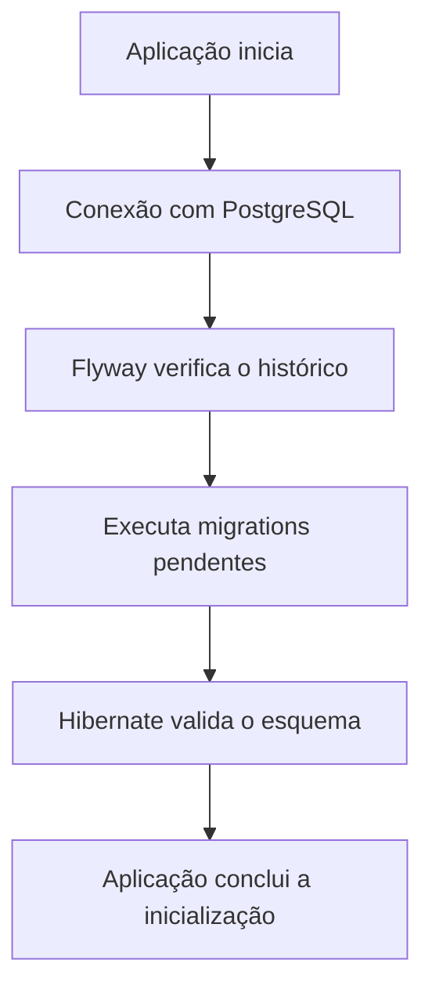

# Gestão de Empresas — Backend


**API REST desenvolvida com Java e Spring Boot** para gerenciamento de eventos, patrocinadores, cotas de patrocínio e informações relacionadas.

O projeto utiliza PostgreSQL para persistência de dados, Flyway para versionamento do banco de dados, Hibernate/JPA para mapeamento objeto-relacional e Spring Security para proteger os endpoints da API. A documentação e os testes das requisições podem ser realizados pelo Swagger UI.

---

## 🧰 Tecnologias utilizadas

| Tecnologia | Utilização |
|---|---|
| **Java 21** | Versão definida como alvo de compilação no projeto. |
| **Spring Boot** | Estrutura principal da aplicação. |
| **Spring Web** | Criação de endpoints REST. |
| **Spring Data JPA / Hibernate** | Persistência e mapeamento das entidades. |
| **PostgreSQL** | Banco de dados relacional. |
| **Flyway** | Versionamento e execução de migrations. |
| **Spring Security** | Autenticação e autorização das requisições. |
| **Springdoc OpenAPI / Swagger UI** | Documentação e testes da API. |
| **Bean Validation** | Validação dos dados recebidos pela API. |

## ⚙️ Pré-requisitos

Antes de executar o projeto, instale ou configure:

- JDK compatível com a versão configurada no `pom.xml`.
- Java 21.
- Maven, caso não utilize o Maven Wrapper.
- PostgreSQL.
- Git.

---

## 🚀 Configuração do ambiente

### 1. Clone o repositório

```bash
git clone https://github.com/NickolasMth/portal-parceiros-atlantida.git
cd portal-parceiros-atlantida/backend/gestao-empresas
```

Ajuste o caminho conforme a estrutura do repositório.

### 2. Crie o banco de dados

No PostgreSQL, crie o banco utilizado pela aplicação:

```sql
CREATE DATABASE portal_rbs_local;
```

O banco deve estar acessível na porta configurada pela aplicação. Neste exemplo, a conexão utiliza `localhost:5432`.

> **Importante:** não é necessário criar manualmente as tabelas, pois elas são gerenciadas pelas migrations do Flyway.

### 3. Configure as variáveis de ambiente

O arquivo `src/main/resources/application.properties` utiliza variáveis de ambiente para obter as credenciais do banco:

```properties
spring.datasource.url=jdbc:postgresql://localhost:5432/portal_rbs_local
spring.datasource.username=${DB_POSTGRES_USERNAME}
spring.datasource.password=${DB_POSTGRES_PASSWORD}
spring.datasource.driver-class-name=org.postgresql.Driver

spring.application.name=gestao-empresas
spring.profiles.default=local

spring.jpa.hibernate.ddl-auto=validate

spring.flyway.enabled=true
spring.flyway.locations=classpath:db/migration
```

Configure as seguintes variáveis no ambiente em que a aplicação será executada:

| Variável | Descrição |
|---|---|
| `DB_POSTGRES_USERNAME` | Usuário do PostgreSQL |
| `DB_POSTGRES_PASSWORD` | Senha do usuário do PostgreSQL |

### 4. Execute a aplicação

Com as variáveis configuradas e o PostgreSQL em execução, inicie o projeto:

```bash
./mvnw spring-boot:run
```

No Windows, utilizando o PowerShell ou o Prompt de Comando:

```powershell
.\mvnw.cmd spring-boot:run
```

Se o Maven Wrapper não estiver disponível, utilize:

```bash
mvn spring-boot:run
```

---

## 🗃️ Gerenciamento do banco de dados com Flyway Migrations

O **Flyway** controla a evolução do esquema do banco de dados por meio de arquivos SQL versionados. Assim, todos os desenvolvedores podem compartilhar as mesmas alterações estruturais sem depender da criação manual de tabelas.

### Como funciona?

As migrations ficam no diretório:

```text
src/
└── main/
    └── resources/
        └── db/
            └── migration/
                ├── V1__criar_tabelas_iniciais.sql
                ├── V2__adicionar_observacao_evento.sql
                └── V3__criar_tabela_exemplo.sql
```

Os nomes seguem o padrão:

```text
V<versao>__<descricao>.sql
```

- `V`: identifica uma migration versionada.
- `<versao>`: indica a versão da alteração.
- `__`: separa a versão da descrição.
- `<descricao>`: explica o objetivo da migration.
- `.sql`: arquivo com os comandos SQL.

A numeração e a descrição são exemplos ilustrativos; mantenha os nomes reais das migrations existentes no projeto.

### Exemplo de migration

Arquivo `V2__adicionar_observacao_evento.sql`:

```sql
ALTER TABLE evento
    ADD COLUMN observacao VARCHAR(200);
```

Essa migration adiciona a coluna `observacao` à tabela `evento`.

Ao iniciar a aplicação, o Flyway identifica as migrations disponíveis, verifica quais já foram executadas e aplica as pendentes, respeitando a ordem das versões.

O histórico é registrado na tabela `flyway_schema_history`, que armazena informações como versão, descrição, checksum e estado de execução.

### O que acontece na inicialização?

Com o Flyway habilitado, o fluxo simplificado é:



No projeto, a propriedade:

```properties
spring.jpa.hibernate.ddl-auto=validate
```

faz com que o Hibernate **valide o esquema, sem criar ou alterar automaticamente as tabelas**. As alterações estruturais devem ser feitas por migrations.

### Regras importantes para trabalhar em equipe

- Cada nova alteração estrutural deve receber uma nova migration.
- Não altere uma migration que já foi executada em um banco compartilhado ou persistente.
- Não reutilize números de versões existentes.
- Inclua as novas migrations no mesmo commit das alterações de código que dependem delas.
- Teste as migrations antes de compartilhar as alterações.

Por exemplo, se a migration `V1` já foi executada e é necessário adicionar uma coluna, crie a `V2` em vez de modificar a `V1`.

Se uma migration já aplicada for editada, o checksum poderá divergir do registrado no banco, causando uma falha de validação. Em bancos com dados importantes, a correção deve preservar o histórico e utilizar uma nova migration quando apropriado.

---

## 📘 Documentação e testes com Swagger

O Swagger UI disponibiliza uma interface web para consultar os endpoints documentados e realizar requisições HTTP diretamente no navegador.

Com a aplicação em execução, acesse:

- **Swagger UI:** [http://localhost:8080/swagger-ui/index.html](http://localhost:8080/swagger-ui/index.html)
- **OpenAPI JSON:** [http://localhost:8080/v3/api-docs](http://localhost:8080/v3/api-docs)

Esses endereços consideram a porta padrão `8080` e o caminho padrão do Springdoc. Se houver configurações personalizadas, os endereços poderão ser diferentes.

### Como testar um endpoint

1. Abra o Swagger UI.
2. Localize o recurso desejado, como `eventos`.
3. Expanda o endpoint, por exemplo, `POST /eventos`.
4. Clique em **Try it out**.
5. Preencha o corpo da requisição em JSON.
6. Clique em **Execute**.
7. Analise o código HTTP e a resposta retornada.

Exemplo de corpo para cadastrar um evento:

```json
{
  "nome": "Planeta Atlântida",
  "edicao": 1,
  "descricao": "Evento musical",
  "dataInicio": "2026-10-13",
  "dataFim": "2026-10-20",
  "local": "São Jerônimo",
  "status": "EM_ANDAMENTO"
}
```

Os valores devem respeitar os campos, as validações e os enums definidos no código. O exemplo é ilustrativo e não garante que o cadastro será aceito pelas regras de negócio atuais.

### Documentação dos endpoints

As anotações do Springdoc/OpenAPI permitem enriquecer a documentação:

| Anotação | Finalidade |
|---|---|
| `@Tag` | Agrupa endpoints por recurso ou assunto. |
| `@Operation` | Define o resumo e a descrição de uma operação. |
| `@ApiResponse` | Documenta respostas HTTP possíveis. |
| `@Parameter` | Explica parâmetros da requisição. |
| `@Schema` | Descreve campos de modelos e DTOs. |
| `@SecurityRequirement` | Indica o esquema de segurança exigido por uma operação documentada. |

Essas anotações documentam a API, mas não substituem a implementação dos endpoints, a validação dos dados ou as regras de segurança.

---

## 🔐 Spring Security e autenticação

O Spring Security controla quais requisições podem acessar os recursos da aplicação. Em uma API REST, a configuração pode permitir o acesso à documentação do Swagger e exigir autenticação para os endpoints de negócio.

Uma configuração com HTTP Basic pode seguir este modelo:

```java
@Configuration
public class SecurityConfig {

    @Bean
    public SecurityFilterChain securityFilterChain(
            HttpSecurity http
    ) throws Exception {

        http
            .csrf(csrf -> csrf.disable())
            .authorizeHttpRequests(auth -> auth
                .requestMatchers(
                    "/swagger-ui/**",
                    "/swagger-ui.html",
                    "/v3/api-docs/**"
                ).permitAll()
                .anyRequest().authenticated()
            )
            .httpBasic(Customizer.withDefaults());

        return http.build();
    }
}
```

> **Atenção:** esse código representa uma configuração de referência. A configuração efetivamente utilizada deve ser conferida no projeto antes de assumir que esses são os caminhos liberados ou o mecanismo de autenticação em uso.

Nesse exemplo:

- `SecurityFilterChain` define as regras de segurança HTTP.
- `permitAll()` permite acessar a documentação sem autenticação.
- `authenticated()` exige autenticação nos demais endpoints.
- `httpBasic()` habilita autenticação HTTP Basic.
- A desativação do CSRF deve ser avaliada de acordo com o modelo de autenticação. Ela pode ser apropriada para uma API stateless que não utiliza autenticação baseada em sessão/cookies, mas não deve ser aplicada indiscriminadamente a aplicações web com sessão.

### Como autenticar no Swagger

Se a aplicação estiver configurada com HTTP Basic:

1. Abra o Swagger UI.
2. Clique em **Authorize**, caso o esquema de segurança esteja documentado no OpenAPI.
3. Informe as credenciais válidas.
4. Confirme a autenticação.
5. Execute o endpoint protegido.

Para exibir o botão de autenticação, o esquema HTTP Basic pode ser documentado com `@SecurityScheme`:

```java
@Configuration
@SecurityScheme(
    name = "basicAuth",
    type = SecuritySchemeType.HTTP,
    scheme = "basic"
)
public class OpenApiConfig {
}
```

As operações protegidas também podem ser documentadas com `@SecurityRequirement`. A configuração OpenAPI informa ao Swagger como apresentar a autenticação; **ela não cria usuários nem substitui as regras reais do Spring Security**.

### De onde vêm as credenciais?

Se não houver usuários e credenciais definidos pela aplicação, o Spring Boot pode gerar um usuário padrão de desenvolvimento com nome `user` e senha aleatória, exibida no console durante a inicialização.

Em uma aplicação real, as credenciais devem ser gerenciadas de forma explícita e segura. Não utilize credenciais padrão como estratégia definitiva de autenticação em produção.

O botão **Authorize** também não garante, por si só, que uma requisição será aceita. As credenciais precisam ser válidas e o endpoint deve estar autorizado pela configuração de segurança.